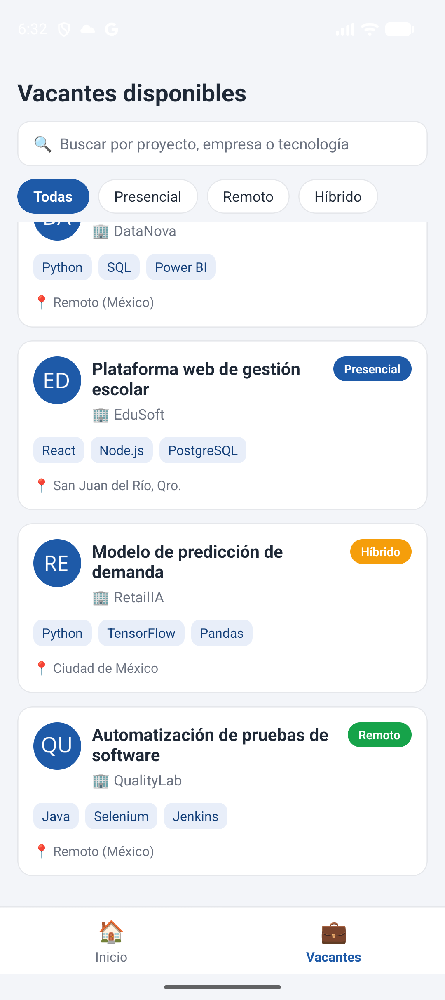

# Residencias Profesionales: UI del estudiante

Maquetación de la interfaz de usuario para el perfil del estudiante en una
plataforma de gestión de residencias profesionales, desarrollada con
React Native. Examen Parcial 1, Desarrollo de Aplicaciones Móviles Inteligentes.

## Pantallas

| Dashboard | Explorador de vacantes | Detalle de vacante |
|---|---|---|
|  |  |  |

- **Dashboard:** bienvenida, indicadores de estado y notificaciones recientes.
- **Explorador de vacantes:** barra de búsqueda, filtros por modalidad y lista
  de tarjetas con proyecto, empresa, tecnologías y modalidad.
- **Detalle de vacante:** descripción, requisitos, ubicación y botón
  "Postularse".

## Tecnologías

React Native, TypeScript, StyleSheet y Flexbox. La navegación se resuelve con
renderizado condicional. Los datos son estáticos.

## Estructura

    App.tsx
    src/
      components/   TabBar, VacanteCard
      data/         datos estáticos
      screens/      Dashboard, Vacantes, DetalleVacante
      theme.ts      paleta de colores

## Cómo ejecutarlo

    npm install
    npx react-native start
    npx react-native run-android

Requiere el entorno de Android configurado (JDK 17, Android Studio y un
emulador).

## Autor

Michel Betancourt